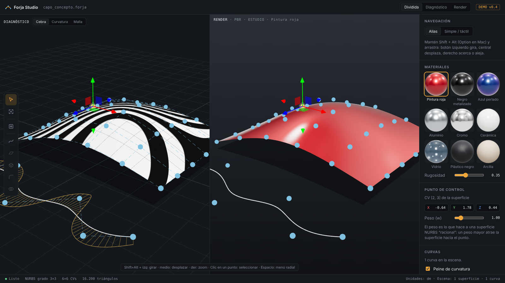

# Forja Studio

Aplicación de modelado 3D en el navegador que busca combinar lo mejor de tres mundos:

- **Superficies NURBS de clase A** como Autodesk Alias.
- **Modelado sólido rápido y preciso** como Plasticity.
- **Visualización realista con shaders** como Blender.

Todo con herramientas gratuitas y de código abierto.

## Visión

El concepto completo está en [docs/concepto.md](docs/concepto.md).

## Cómo probarla

Abre `index.html` en Chrome o Edge, o usa el enlace de GitHub Pages cuando esté activado.

- Navegación Alias (por defecto en computadora): `Shift+Alt` (`Shift+Option` en Mac) + botón izquierdo gira, central desplaza, derecho acerca o aleja
- Navegación simple: arrastrar gira, botón derecho desplaza
- `Espacio` (mantener): menú radial · `V`: cambiar vista (Dividida → Diagnóstico → Render) · `1` `2` `3`: cebra, curvatura, malla
- Rueda: zoom
- Clic en un punto azul: seleccionar un punto de control y moverlo con el gizmo
- `C`: dibujar curva · `Enter`: terminar curva · `T`: vista superior
- `F`: encuadrar · `Esc`: cancelar o deseleccionar · `Supr`: borrar la curva seleccionada

## Estado actual (demo v0.4)

Por ahora la app se diseña y prueba solo para laptop/computadora.

| Función | Estado |
|---|---|
| Superficie NURBS grado 3×3 con 6×6 puntos de control editables | ✅ |
| Peso (w) por punto de control (NURBS racional) | ✅ |
| Materiales realistas: pintura, aluminio, cerámica, vidrio, arcilla | ✅ |
| Análisis cebra | ✅ |
| Mapa de curvatura media | ✅ |
| Dibujar curvas NURBS (grado 3) sobre el suelo, con imán a la cuadrícula | ✅ |
| Peine de curvatura (como Alias) | ✅ |
| Editar y borrar curvas | ✅ |
| Navegación estilo Alias (Shift+Alt + 3 botones) | ✅ |
| Vista dividida Diagnóstico \| Render con cámara compartida | ✅ |
| Menú radial (mantener Espacio) | ✅ |
| Biblioteca de 9 materiales con miniaturas | ✅ |
| Barrido, extrusión, redondeo, booleanas | 🔜 |

## Tecnología

- [three.js](https://threejs.org) 0.160 para el visor y los materiales PBR.
- Próximo: [OpenCASCADE](https://dev.opencascade.org) compilado a WebAssembly para sólidos B-rep, booleanas y redondeos.
