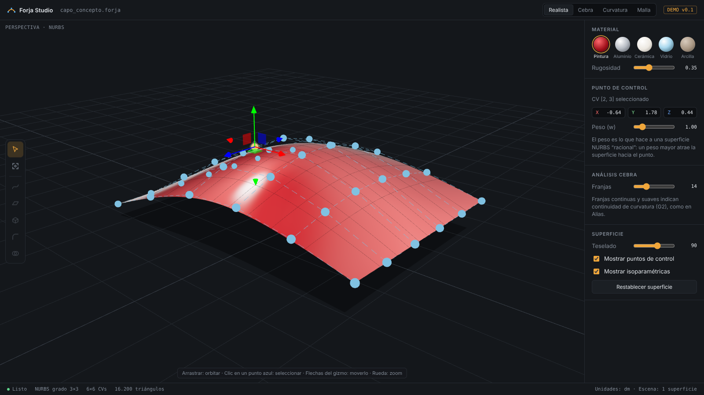

# Forja Studio

Aplicación de modelado 3D en el navegador que busca combinar lo mejor de tres mundos:

- **Superficies NURBS de clase A** como Autodesk Alias.
- **Modelado sólido rápido y preciso** como Plasticity.
- **Visualización realista con shaders** como Blender.

Todo con herramientas gratuitas y de código abierto.

## Cómo probarla

Abre `index.html` en Chrome o Edge, o usa el enlace de GitHub Pages cuando esté activado.

- Arrastrar: orbitar la vista
- Rueda: zoom
- Clic en un punto azul: seleccionar un punto de control y moverlo con el gizmo
- `F`: encuadrar · `Esc`: deseleccionar

## Estado actual (demo v0.1)

| Función | Estado |
|---|---|
| Superficie NURBS grado 3×3 con 6×6 puntos de control editables | ✅ |
| Peso (w) por punto de control (NURBS racional) | ✅ |
| Materiales realistas: pintura, aluminio, cerámica, vidrio, arcilla | ✅ |
| Análisis cebra | ✅ |
| Mapa de curvatura media | ✅ |
| Curvas, barrido, extrusión, redondeo, booleanas | 🔜 |

## Tecnología

- [three.js](https://threejs.org) 0.160 para el visor y los materiales PBR.
- Próximo: [OpenCASCADE](https://dev.opencascade.org) compilado a WebAssembly para sólidos B-rep, booleanas y redondeos.
