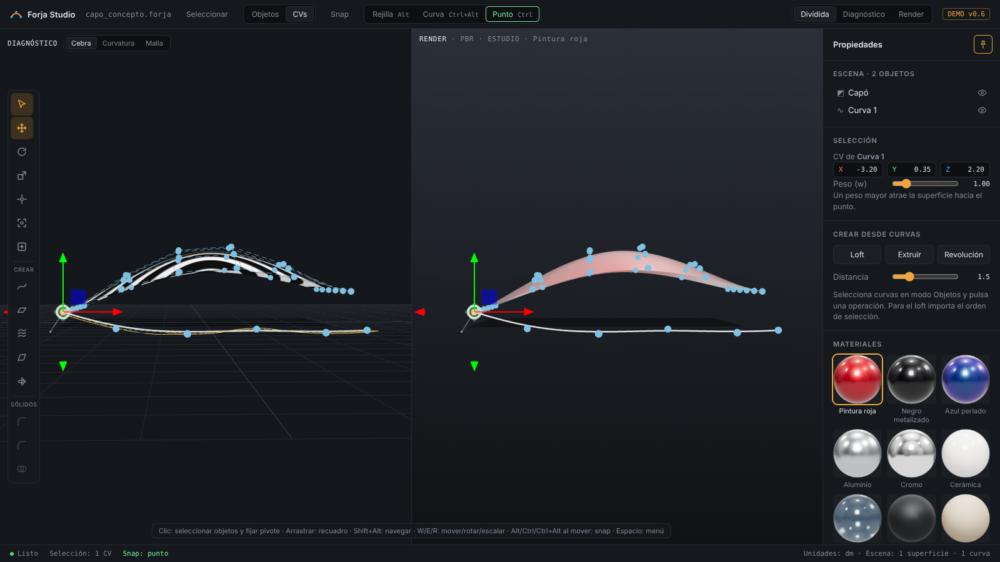

# Forja Studio

Aplicación de modelado 3D en el navegador que busca combinar lo mejor de tres mundos:

- **Superficies NURBS de clase A** como Autodesk Alias.
- **Modelado sólido rápido y preciso** como Plasticity.
- **Visualización realista con shaders** como Blender.

Todo con herramientas gratuitas y de código abierto.

## Visión

El concepto completo está en [docs/concepto.md](docs/concepto.md).

## Cómo probarla

Abre https://eposboca9.github.io/forja-studio/ en Chrome o Edge (por ahora pensada para laptop/computadora).

| Acción | Cómo |
|---|---|
| Girar / desplazar / zoom (Alias) | `Shift+Alt` + botón izquierdo / central / derecho · el pivote queda fijo |
| Pivote de la cámara | Clic sobre un objeto · `L`: a la selección |
| Seleccionar | Izq elige · medio añade · der quita · arrastrar = recuadro · `Shift` alterna · `Ctrl`+flechas: CV vecino |
| Transformar | `W` mover · `E` rotar · `R` escalar (alrededor del pivote de cada objeto) · `D` editar pivote |
| Snap | Mantener `Alt` rejilla · `Ctrl` punto · `Ctrl+Alt` curva, o botones fijos arriba |
| Menú radial | Mantener `Espacio` o `Ctrl+Shift` + clic |
| Objetos o CVs | `O` / `P` (o los botones de arriba) |
| Curva | `C` · `Enter` termina · plano de dibujo: suelo o frontal |
| Crear superficies | Plano, Loft, Extruir, Revolución (barra izquierda o panel) |
| Grado y spans | Selecciona una superficie o curva y cámbialos en el panel |
| Vistas | `V` Dividida → Diagnóstico → Render · `1` `2` `3` cebra, curvatura, malla |
| Encuadrar / vista superior | `F` / `T` |
| Borrar | `Supr` |

Los paneles laterales se ocultan solos: acerca el cursor al borde derecho (propiedades) o izquierdo (herramientas). El botón de chincheta los fija.

## Estado actual (demo v0.6)

| Función | Estado |
|---|---|
| Superficies y curvas NURBS editables por CVs, con peso (w) | ✅ |
| Selección de objetos y CVs: clic, recuadro, Shift/Ctrl | ✅ |
| Pivote de giro movible (doble clic / L) | ✅ |
| Grado (1–7) y spans de superficies y curvas | ✅ |
| Crear superficies: plano, loft, extrusión, revolución | ✅ |
| Vista dividida Diagnóstico \| Render, cebra, curvatura, peine | ✅ |
| Menú radial y paneles que se ocultan solos | ✅ |
| Pivote de cámara anclado, pivote por objeto, rotar/escalar | ✅ |
| Snap de rejilla, punto y curva (como Alias) | ✅ |
| Biblioteca de 9 materiales con miniaturas | ✅ |
| Sólidos: extruir, redondeo (fillet), chaflán, booleanas | 🔜 v0.6 (OpenCASCADE) |

## Tecnología

- [three.js](https://threejs.org) 0.160 para el visor y los materiales PBR.
- `src/nurbs.js`: matemática NURBS (nudos, ajuste, loft, extrusión, revolución, reconstrucción).
- `src/main.js`: escena, selección, herramientas e interfaz.
- Próximo: [OpenCASCADE](https://dev.opencascade.org) compilado a WebAssembly para sólidos B-rep, booleanas y redondeos.
